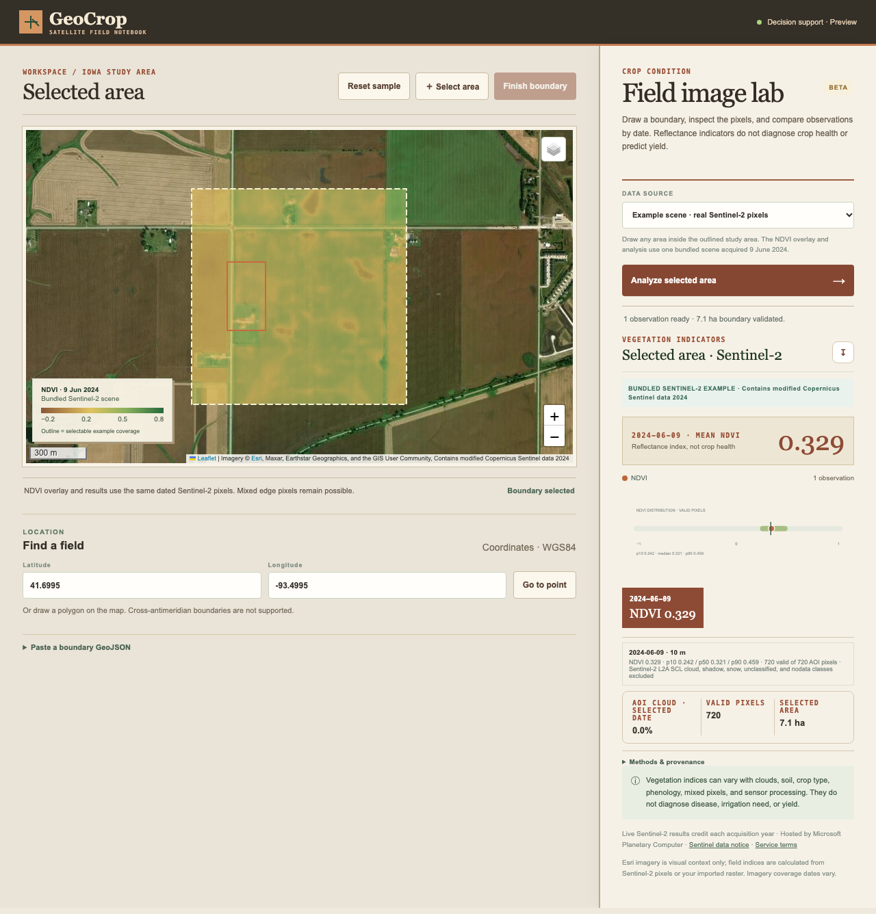

# GeoCrop

[Frontend release audit](docs/frontend-audit.md)

GeoCrop is a responsive satellite field notebook for exploring vegetation indicators over a field boundary. Its default selectable example uses bundled, dated Sentinel-2 pixels. It is decision support, not agronomic diagnosis or yield prediction.

**Live demo:** [geocrop-three.vercel.app](https://geocrop-three.vercel.app)



[Mobile workflow screenshot](docs/screenshots/mobile.png)

### Try it in one minute

1. Open the live demo. The dashed outline marks a bundled Sentinel-2 scene from **9 June 2024**. Click **Select area**, draw a polygon anywhere inside the outline, then **Finish boundary** and **Analyze selected area**. The overlay and result use the same real pixels. [Implementation and scientific limits](docs/example-scene.md).
2. Switch to **Synthetic time series** for an explicitly illustrative seasonal demo, or **Live catalog** to search and analyze other real Sentinel-2 scenes. [Live result screenshot](docs/screenshots/live-sentinel.png).
3. Select a dated observation in the ledger to inspect its NDVI, cloud, and valid-pixel values. Open **Methods & provenance**, then export the CSV. See the [independent real-scene reference check](docs/science-validation.md) for one reproducible comparison and its scientific limits.

## Quick start

Requirements: Python 3.11+ (3.12 recommended), [uv](https://docs.astral.sh/uv/), Node.js 20+, and a modern browser. No credentials are needed for the bundled example or synthetic demo.

```sh
uv sync --locked --extra test --python 3.12
npm ci
```

In one terminal run `uv run --locked uvicorn geocrop.api:app --reload`; in another run `npm run dev`. Open <http://localhost:5173>. The sample Iowa boundary is ready to analyze against the bundled 2024 scene. To run the production build locally, use `npm run build` then `uv run --locked uvicorn geocrop.api:app`; FastAPI serves `dist/` when it exists. `uv.lock` pins the Python dependency graph for local, CI, and Docker installs.

## What works

- Draw a polygon or use latitude/longitude to navigate. Boundaries use WGS84 / EPSG:4326, one valid polygon, no holes, no antimeridian crossing, 0.1–10,000 ha, up to 2,000 vertices. Date spans are limited to 1,095 days.
- **Selectable real-scene example:** one bundled Sentinel-2 L2A acquisition over a visibly outlined Iowa study area. Draw any polygon inside the outline for cloud-masked NDVI mean, percentiles, pixel counts, provenance, and CSV. The map overlay is generated from the same source pixels as the analysis. The example is historical and single-date; [method and limits](docs/example-scene.md).
- **Synthetic demo:** repeatable hand-authored 10 m reflectance grid for the sample Iowa field; cloud and no-data masks; NDVI/NDMI summaries; time-series and CSV with provenance. All values are labeled synthetic. Other AOIs are rejected in demo mode rather than returning misleading empty statistics.
- **Live Sentinel‑2 analysis:** searches Planetary Computer STAC for Sentinel‑2 L2A. Analyze one scene or select up to five scenes for chronological observations. Each response includes scene ID, acquisition/cloud metadata, valid and masked pixels, quantiles, scale/offset, CRS, and processing grid; CSV export preserves per-scene provenance. Each date is processed independently; failures are reported and never interpolated. Pixel analysis is capped at 1,000,000 B04 window pixels per scene; larger areas fail explicitly. Scene previews remain visual context only.
- **Import:** calculates NDVI/NDMI from a user-provided GeoTIFF clipped to the selected AOI. Supply red, NIR, and SWIR as bands 1–3, reflectance scaled to 0–1, with a CRS and no more than 5 million pixels / 20 MB. The import date and sensor tags are unverified. No automatic resampling is performed.

## Architecture

- `src/`: TypeScript + Vite UI; Leaflet map with Esri World Imagery by default and an OpenStreetMap street layer option.
- `geocrop/api.py`: FastAPI endpoints, bounded STAC search/cache, SAS asset signing, bundled example, live analysis, import handling and response validation. `geocrop/example.py` analyzes a committed compact real-scene raster. `geocrop/live.py` aligns B08 bilinearly and SCL with nearest-neighbor to the B04 10 m grid before cloud/nodata masking and NDVI calculation.
- `geocrop/geo.py`: WGS84 geometry/area checks, EPSG:32615 synthetic raster grid, index and mask calculations.
- No account, external farm-location storage, queue, database, or AI service. AOIs are sent to the STAC provider for live search and again with the selected scene for pixel analysis. Live assets are signed server-side through Planetary Computer and read through bounded COG range access; signed URLs are never returned to the browser. Bundled example, synthetic demo, and import calculations are local to the server process. The selected basemap provider receives viewport tile requests, which reveal the approximate map area and network address to that service; basemap imagery is visual context and is not used for vegetation-index calculations.

## Methods and data dictionary

| Field            | Meaning                                                                                                                                                                                                             |
| ---------------- | ------------------------------------------------------------------------------------------------------------------------------------------------------------------------------------------------------------------- |
| `ndvi`           | `(NIR − Red) / (NIR + Red)`; unitless, mathematically bounded −1 to 1 when inputs are nonnegative and denominator is positive.                                                                                      |
| `ndmi`           | `(NIR − SWIR) / (NIR + SWIR)`; unitless, same bound under those conditions.                                                                                                                                         |
| `cloud_percent`  | Synthetic SCL-like class 9 fraction for demo; Sentinel-2 SCL cloud classes 8–10 over AOI pixels for bundled and live analysis; absent for imports. Catalog `eo:cloud_cover` describes the whole scene, not the AOI. |
| `nodata_percent` | Synthetic class 0 fraction for demo; Sentinel-2 SCL class 0 or missing reflectance pixels for bundled and live analysis. Imported data uses its own masks/nodata.                                                   |
| `pixel_count`    | Unmasked pixels contributing to the AOI mean; not a count of plants or a precise field-edge measurement.                                                                                                            |
| `resolution_m`   | Nominal pixel size where known. Edge pixels and mixed land cover make field means approximate.                                                                                                                      |
| `area_ha`        | Geodesic polygon area calculated on the WGS84 ellipsoid.                                                                                                                                                            |

Live Sentinel‑2 L2A B04 red and B08 NIR are processed on the native B04 10 m grid; B08 is bilinearly aligned if the scene grid differs, and 20 m SCL is nearest-neighbor aligned. The bundled example uses a separate Web Mercator grid so its PNG pixels align with Leaflet; B04/B08 are bilinearly resampled and SCL uses nearest-neighbor. Both use STAC `raster:bands` scale/offset (default scale 0.0001, offset 0), exclude SCL classes 0,1,2,3,7,8,9,10,11 and invalid denominators, and report p10/p50/p90. The 1,000,000-pixel limit applies to the clipped B04 scene window. A live result covers only that scene and selected AOI, not the entire farm. For imports, scale to unit reflectance first; processing and mask quality are not independently verified. Synthetic arrays share a 10 m EPSG:32615 grid, so no resampling occurs. Synthetic values are not satellite observations.

Indices show spectral surface conditions. Clouds, nodata, mixed pixels, soil, crop type, phenology, sensor differences, atmospheric processing, and acquisition timing limit interpretation. They do not identify crop type, diagnose disease, determine irrigation need, establish causality, or predict yield. Unit tests check implementation behavior, not scientific validity.

## Data sources, attribution, and terms

| Source                            | Use                                                                                                       | Attribution / terms                                                                                                                                                                                                                                                                                                                                                                                                                    |
| --------------------------------- | --------------------------------------------------------------------------------------------------------- | -------------------------------------------------------------------------------------------------------------------------------------------------------------------------------------------------------------------------------------------------------------------------------------------------------------------------------------------------------------------------------------------------------------------------------------- |
| Microsoft Planetary Computer STAC | Live Sentinel‑2 L2A metadata search; 5-minute in-memory cache                                             | [STAC API](https://planetarycomputer.microsoft.com/docs/reference/stac/), [Sentinel‑2 collection](https://planetarycomputer.microsoft.com/api/stac/v1/collections/sentinel-2-l2a), [Planetary Computer terms](https://planetarycomputer.microsoft.com/terms). Anonymous STAC metadata is currently accessible; some asset data access uses temporary SAS signing and is throttled.                                                     |
| ESA / Copernicus Sentinel‑2       | Underlying source imagery; bundled example includes a small modified pixel excerpt and NDVI visualization | [Copernicus Sentinel legal notice](https://sentinels.copernicus.eu/documents/247904/690755/Sentinel_Data_Legal_Notice); bundled and live results and exports credit “Contains modified Copernicus Sentinel data [Year]”. The collection metadata also lists Microsoft as host and Esri as processor. The STAC `license: proprietary` label describes the collection record; it is not treated here as the underlying Sentinel license. |
| Esri World Imagery                | Default display basemap only                                                                              | [Esri attribution and service terms](https://support.esri.com/en-us/knowledge-base/what-is-the-correct-way-to-cite-an-arcgis-online-basema-000012040); imagery sources and capture dates vary by location. Use the street-map switch if imagery is unavailable.                                                                                                                                                                        |
| OpenStreetMap                     | Optional street-map layer                                                                                 | © OpenStreetMap contributors; [copyright and attribution](https://www.openstreetmap.org/copyright). Public tile service usage limits apply; production deployments should choose an appropriate tile service.                                                                                                                                                                                                                          |
| Synthetic fixture                 | Offline demo only                                                                                         | Hand-authored by this project; explicitly synthetic, no external license or observation claims.                                                                                                                                                                                                                                                                                                                                        |

Terms and endpoints were checked on 2026-10-21. Provider terms and availability can change; re-check before production use. This project does not distribute original source COGs; it includes a small modified excerpt for the offline example.

## Environment and limits

Copy `.env.example` only if changing deployment values. The STAC URL defaults to the official Planetary Computer host; never set it from request data. Limits default to 10,000 ha, 1,095 days, 20 catalog results, 5-minute metadata cache, 60 API requests/minute/IP, 20 MB/5-million-pixel user imports, and 1 million live Sentinel-2 AOI-window pixels. Live pixel reads use 8-second GDAL network timeouts and one retry; the catalog/STAC calls use an 8-second timeout. Live search has an 8-second request timeout and one retry. Cache entries are in-memory and disappear on restart. No secrets are required or logged. AOIs are not logged or persisted.

`/api/health` reports process readiness, not upstream provider availability. `/api/analysis/example` analyzes a polygon within the bundled Iowa scene without an upstream request. `/api/catalog/search` validates the AOI and sends it to the configured public catalog. `/api/analysis/demo` is limited to the sample Iowa AOI; `/api/analysis/import` returns user-raster statistics; `/api/analysis/live` accepts only a scene ID from the fixed Sentinel-2 collection and processes signed B04/B08/SCL assets server-side. Provider failures return an explicit error and never fall back to synthetic data. Every API request body is streamed through a hard byte cap (1 MB normally; 20 MB plus multipart overhead for imports), even when the request has no `Content-Length`. At most 4 API request bodies and 1 raster import are buffered/processed at once per process. Errors are bounded and user-facing; provider URLs are fixed by the service, not supplied by a browser.

## Tests and CI

```sh
pytest
ruff check geocrop tests scripts
ruff format --check geocrop tests scripts
npm run format:check
npm run typecheck
npm test
npm run build
```

The Playwright smoke flow runs against the production build served by FastAPI and covers the default basemap policy, bundled example and synthetic analysis, chart/quality display, CSV export, coordinate navigation, source selection, and stale-result protection. CI runs Python lint/format, API and geometry tests, frontend type checking, E2E interactions, format checking, and the production build. It downloads Chromium for the E2E browser. Unit and fixture tests cover masked NDVI, cloud/nodata classes, empty valid pixels, 20 m-to-10 m resampling, CRS/grid handling, and the demo path. The [independent live reference script](scripts/verify_live_reference.py) is run separately because Planetary Computer and Azure asset availability is outside CI's control.

## Deployment runbook

Build a self-contained app image with Docker and run it on port 8000:

```sh
docker compose up --build
```

Then check `http://localhost:8000/api/health` and visit `http://localhost:8000`. The image includes the static frontend and geospatial API. No database or paid services are needed. Live catalog and imagery requests use public services with their own availability and rate limits.

The public deployment serves the Vite frontend on Vercel and runs the geospatial API in a Docker service on Render Free. `vercel.json` forwards `/api/*` to `https://geocrop-loe5.onrender.com/api/*`, keeping browser requests on one origin. The backend itself is available at [geocrop-loe5.onrender.com](https://geocrop-loe5.onrender.com). The Render Blueprint in `render.yaml` uses a public GitHub URL; because the repository is not installed into the Render GitHub integration, future backend changes require a manual Blueprint sync. Vercel deploys the frontend from `main` automatically. Render Free spins down after inactivity, so the first API call can take 50 seconds or more; review [Render's current free-plan limits](https://render.com/docs/free). No database or paid services are configured. The public Vercel route was checked with synthetic analysis, live Sentinel analysis, and a 9.7 MB GeoTIFF import.

Vercel and Render terminate TLS for this public demo. For heavier public use, add shared operational rate limiting and an appropriate tile provider. The included in-process per-IP limiter is for a small demonstrator, not a substitute for a production gateway. Uploaded files are processed in memory and discarded. Farm boundaries remain in browser/server memory for the request only.

## Troubleshooting

- If `npm ci` fails, use Node 20 or later and rerun it after removing `node_modules`.
- If live scene search or pixel processing fails, check the public STAC/SAS service and try another scene or a smaller AOI; use the explicitly labeled synthetic demo or raster import as an independent workflow.
- If an import is rejected, check band order, unit reflectance scaling, CRS, pixel dimensions, file size, and AOI overlap.
- If the map is blank, check access to Esri World Imagery and try the street-map layer; the demo analysis still runs without the basemap.
